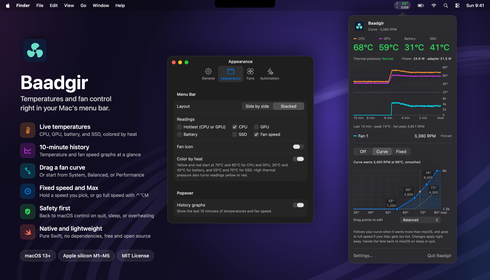

<div align="center">

# Baadgir: Mac fan control and temperature monitor

**A free, open-source menu bar app for Apple silicon Macs.**
See CPU, GPU, battery and SSD temperatures at a glance, and take control of your fans when macOS waits too long.


</div>

<p align="center">
  
</p>

## Why Baadgir?

macOS keeps the fans quiet until your Mac is already hot. That's fine for email, but during a long export, build or game your MacBook Pro can throttle before the fans catch up. Baadgir lets you cool it down earlier, and hands control back to macOS when you're done.

- 🌡️ **Live temperatures in the menu bar.** CPU, GPU, battery and SSD readings and fan RPM, side by side or stacked, colored green, yellow or red. The popover adds power draw and thermal pressure.
- 📈 **10-minute history graphs** of temperature and fan speed, right in the popover.
- 🌀 **Custom fan curve.** Drag four temperature → RPM points right in the popover, or start from the System, Balanced or Performance preset. Baadgir only speeds the fans up, never below the speed macOS was running when Curve took over, and enforces a safe minimum.
- 🎚️ **Fixed speed.** Hold the fans at a speed you pick with a slider, within limits you set.
- 🚀 **One-key Max.** Full fan speed from the right-click menu, or <kbd>⌃</kbd><kbd>⌥</kbd><kbd>M</kbd> from any app.
- ⚡ **Automation.** Switch to Curve or Max when you plug in, and turn fan control off on battery. Also works with Shortcuts, `baadgir://` links and a command-line tool.
- 🛡️ **Safety first.** Fans go back to macOS automatic control on quit, sleep, a crash, overheating or a sensor failure.
- 🔒 **Private and lightweight.** Native Swift and SwiftUI with no dependencies, no network access, no analytics and no logs.

## Fan modes

| Mode | What it does |
| --- | --- |
| **Off** | macOS controls the fans, as usual. |
| **Curve** | Your temperature → RPM curve, used only when it wants more cooling than macOS. |
| **Fixed** | A speed you pick with the slider, within the limits in Settings → Fans. |
| **Max** | Fans at full speed until you choose another mode. Start it from the right-click menu or <kbd>⌃</kbd><kbd>⌥</kbd><kbd>M</kbd>; it shows in the popover's switch while it runs. |

Off, Curve and Fixed sit in the popover's switch. The mode you pick stays on until you choose Off, and starts again when Baadgir opens.

## Install

You need an Apple silicon Mac (M1 to M5), macOS 13 or later, and the Xcode Command Line Tools (`xcode-select --install`).

```sh
git clone https://github.com/devbymak/baadgir.git
cd baadgir
./build.sh --install
```

This builds the app, installs a small root-owned fan-control helper, and copies Baadgir to `/Applications`. It asks for your password once, to install the helper and a sudo rule (`/etc/sudoers.d/baadgir`) that lets your account start only that helper without a password. After that, Baadgir switches modes without asking and starts the mode you last picked when it opens.

**Supported Macs:** Apple silicon Macs with fans, including two-fan 14" and 16" MacBook Pro models (both fans move together). On a fanless MacBook Air, Baadgir shows temperatures only. Run `baadgir status` to see the chip, fans and sensors it found.

<details>
<summary><b>Shortcuts, links and command line</b></summary>

Turn on Settings → Automation → Shortcuts, links, and command line first. It's off by default because any app or web page can open a link. Baadgir still asks for confirmation before it starts cooling or sets a fixed speed.

- **Shortcuts:** add an *Open URLs* action with `baadgir://off`, `baadgir://curve`, `baadgir://max` or `baadgir://fixed?rpm=3000`. The older `auto` and `manual` names still work.
- **Terminal:**

  ```sh
  ln -s /Applications/Baadgir.app/Contents/MacOS/baadgir /usr/local/bin/baadgir
  baadgir status        # read-only readings
  baadgir max           # or off, curve, fixed 3000
  ```

</details>

<details>
<summary><b>Uninstall</b></summary>

Choose Off, quit Baadgir, delete the app, then run:

```sh
sudo rm -f /Library/PrivilegedHelperTools/local.baadgir.helper /var/db/local.baadgir.lock /etc/sudoers.d/baadgir
```

</details>

## Safety

> [!WARNING]
> Baadgir is experimental. It uses Apple's undocumented SMC interface, and fan control has not been verified on every Mac. Use it at your own risk.

<details>
<summary><b>How Baadgir keeps your Mac safe</b></summary>

- **Curve** never runs below a safe minimum for the current temperature (the fans' minimum up to 65°C, a quarter of their range at 72°C, half at 78°C). It switches to full speed at 80°C CPU/GPU, a 45°C battery, a 70°C SSD or high thermal pressure, and hands the fans back to macOS once macOS's own speed is enough. It follows a smoothed temperature so the fans don't hunt, but the safe minimum and cutoffs use the raw readings. While Curve holds the fans, macOS's live choice can't be read, so Curve won't follow a rise macOS would make for sensors Baadgir doesn't watch; the safe minimum and these cutoffs cover that.
- **Fixed** can run below Curve's safe minimum. It only starts below 75°C, never goes under 1000 RPM, and turns fan control off at 80°C, a hot battery or SSD, high thermal pressure or a sensor failure.
- **Max** has no cutoff because it never lowers fan speed.
- **Watchdogs:** the root helper hands the fans back to macOS if the app stops responding for 10 seconds, and a separate watchdog does the same if the helper itself stalls for 15 seconds.
- **Least privilege:** only a root-owned helper runs as root, never the app bundle, and the app checks that helper before starting it. The sudo rule covers only that helper, so any app running as you can start it without a password, but only within the limits above. Apple's thermal services are never disabled.

These are conservative software limits, not certified safety limits. If automatic control can't be restored, restart your Mac. Don't run other fan-control apps at the same time.

</details>

## FAQ

**Is Baadgir free?** Yes. It's open source under the MIT license.

**Does it work on M4 and M5 Macs?** Yes, M1 through M5 are supported. A newer chip still shows temperatures and offers Off and Max until its sensors are added.

**Will it drain my battery?** Baadgir is a small native app that reads sensors once a second. The helper runs only while you use Curve, Fixed or Max, and you can turn fan control off on battery.

**Why the name?** *Baadgir* (بادگیر) means "windcatcher": the Persian towers that have cooled buildings by catching the wind for centuries.

## Credits

Sensor-key reference: [Stats](https://github.com/exelban/stats/blob/master/Modules/Sensors/values.swift).

## License

MIT. See [license](license).
